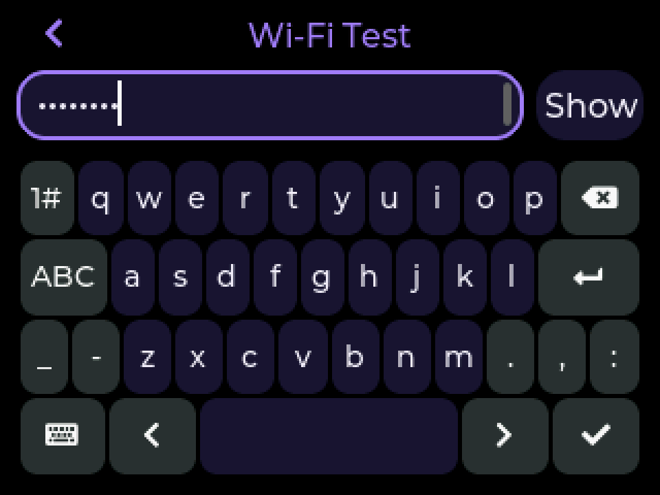

# Muse · 立创实战派 ESP32-S3 UI 适配

让立创实战派 ESP32-S3 使用适合 320×240 横屏的 Muse 界面，支持中英文切换，并包含这次实机调试中完成的显示、触摸和配网内存修复。

基于 [Muse Gadget SDK](https://github.com/facebookincubator/muse-gadget-sdk)，适配基线为 `b139b45064b4dcecf7bfe97e75bc7f99c10c28b6`。这是社区适配，尚未合入上游。**使用本仓库的 `lichuang-ui` 分支，选择实战派配置编译即可获得这些改动，不需要逐个复制 UI 文件。** `main` 保留上游版本，适配内容在默认分支 `lichuang-ui`。

[开始配置与烧录](docs/lichuang/getting-started.md) · [界面使用与修改](docs/lichuang/ui.md) · [常见报错与排查](docs/lichuang/troubleshooting.md)

## 适用硬件

本次实机验证范围：**立创实战派 ESP32-S3，16 MB Flash、8 MB PSRAM、320×240 ST7789 横屏、FT6336 触摸、ES8311 扬声器、ES7210 双麦克风**。

板型配置为 [`sdkconfig.muse-lichuang-szp`](esp32/devices/sdkconfig.muse-lichuang-szp)，详细引脚和适配记录见[设备说明](esp32/devices/lichuang-szp.md)。其他立创板型不能只凭品牌或 ESP32-S3 芯片名使用这个固件；请先核对屏幕、触摸、音频和引脚。仓库保留了上游其他板型，它们不属于本次实机验证范围。

## 已经适配了什么

| 内容 | 使用效果 |
|---|---|
| 320×240 横屏布局 | 设置列表可滚动，标题、输入框和键盘在屏幕内 |
| 中英文界面 | 设置第一行切换，即时生效，重启保留；首次安装默认中文 |
| 中文字体 | 设置与提示显示中文；网络名、密码、聊天内容保持原文 |
| 输入页 | 顶部标题和输入框、底部四行键盘，密码可显示或隐藏 |
| 屏幕和触摸 | 修正低有效背光、LCD 初始化/片选顺序和触摸坐标变换 |
| 配网内存 | 使用双 8 行刷新缓冲区，给蓝牙配网任务保留内部内存 |
| 音频外设 | 接入 ES8311 / ES7210，已有采集、播放和回环验证记录 |

下图为设备内部 UI 截图，使用测试网络名，密码处于隐藏状态；不代表在线对话已经成功。

| 中文输入页 | English input |
|---|---|
|  |  |

## 怎样用到自己的板子上

1. 下载或克隆本适配仓库，放到英文、无空格路径。
2. 安装并激活 ESP-IDF **v6.0.1**。
3. 按[快速开始](docs/lichuang/getting-started.md)加载实战派配置，填入自己的 Muse SDK token。
4. 备份原固件，完成首次配置区初始化和烧录。
5. 检查显示、触摸、语言切换，再通过 Muse App 配对并连接 Wi-Fi。

UI 和板型配置已经在源码中。账号、SDK token 和 Wi-Fi 由每位使用者自行配置；当前个人固件包含构建者的 SDK token，不作为通用下载包分发。

## 当前验证状态

2026-10-10 的既有实机记录确认：编译和烧录通过，显示、触摸、声音得到用户确认；配对、Wi-Fi 联网和语言选择重启保留已有验证。历史完整测试套件记录为 183 项通过。完整记录及本次整理检查见[验证说明](docs/lichuang/validation.md)。

**设备访问 Muse 云端仍有超时，端到端在线对话尚未验证。** 界面可以显示并不等于云端服务已经连通，详见[网络排查](docs/lichuang/troubleshooting.md)。

中文界面不包含拼音输入法；本次没有新增回复自动朗读功能。这个板型关闭 OTA，后续更新使用对应源码重新构建、USB 烧录。

## 与配套文章的关系

《我让 Codex 给 ESP32 装上 Muse，最费劲的是烧录之后》讲述调试过程。本仓库提供文章对应的适配源码、使用步骤和排障方法。文章尚未提供公开链接。

## 来源与许可

保留上游 [LICENSE](LICENSE) 和文件署名。第三方依赖及默认头像的许可范围见[上游说明](README.md#license)；默认 Jollybot 头像不在 Apache-2.0 许可范围内。本次新增文档与代码中的修改应和上游来源一起保留，不将整个 SDK 表述为本项目原创。
